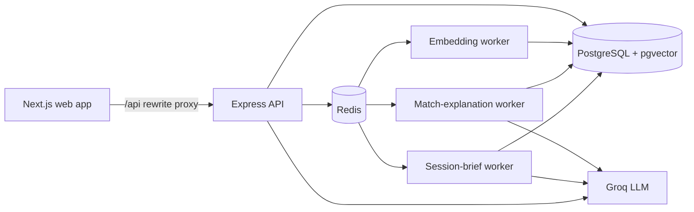

# MentorLoop

A mentor founder portal matching that explains itself, can't double-book, and turns every session into tracked progress.

Built for the KIIT E-Cell tech domain assignment (Mentor–Startup Matching Platform).

Most mentor directories stop at an introduction. MentorLoop covers the whole relationship: it matches founders with mentors and says *why*, handles booking safely, prepares both sides before each session with an AI digest, turns messy session notes into tracked action items, and feeds ratings back into future matches. That feedback is the loop.

> Status: MVP is  implemented and working locally. Chat, live notifications, reminders, deployment and the analytics dashboard are planned but not built. See [What is and isn't built](#what-is-and-isnt-built).

---

## Contents

1. [How it works](#how-it-works)
2. [Architecture](#architecture)
3. [Design choices and trade-offs](#design-choices-and-trade-offs)
4. [Data model](#data-model)
5. [What is and isn't built](#what-is-and-isnt-built)
6. [Getting started](#getting-started)
7. [Configuration](#configuration)
8. [Project structure](#project-structure)
9. [Testing](#testing)

---

## How it works

**Roles**

| Role | What they do |
|---|---|
| Founder | Signs up with a verified `@kiit.ac.in` email, describes their startup, gets ranked mentors, requests a connection, books sessions, tracks action items, logs milestones. |
| Mentor | Signs up openly, completes an expertise profile, waits for admin approval, sets availability and capacity, browses a ranked startup feed, accepts or invites, runs sessions. |
| Admin (E-Cell) | Approves or rejects mentors, reviews users, feedback and analytics, and tunes the matching weights. |

**The journey**

1. **Onboard.** Both sides complete a resumable wizard. Domains, skills and stages come from a shared catalog so everyone uses the same vocabulary.
2. **Match.** Founders see mentors ranked for their startup; mentors see a ranked startup feed. Every result shows a score breakdown and a short explanation of why it fits.
3. **Connect.** A founder requests, or a mentor invites, with an intro message. The other side accepts or declines.
4. **Book.** Mentors publish weekly availability in their own timezone. Founders book real, conflict-free slots and can reschedule or cancel. Sessions export as calendar files.
5. **Prepare.** The founder submits a short brief. A background job turns it into an AI digest for the mentor: summary, key questions, suggested focus.
6. **Follow through.** After the session, notes are pasted in and the AI proposes action items. A person reviews and edits them before anything is saved. Both sides track status, owners and due dates.
7. **Close the loop.** Participants rate the session. Ratings feed the mentor's track-record signal, and founders log milestones and stage changes. A stage change re-embeds the startup so future matches reflect where it is now.

---

## Architecture



- **Monorepo** with three npm workspaces: `apps/web` (Next.js 15 / React 19), `apps/api` (Express, Drizzle ORM, BullMQ workers) and `packages/shared` (Zod schemas and types used by both).
- **PostgreSQL 16 with pgvector** is the single source of truth, including vectors.
- **Redis + BullMQ** run all slow or unreliable work off the request path.
- **Groq** provides the language models. **Embeddings** run locally in-process.

---

## Design choices and trade-offs

### 1. A separate API instead of Next.js route handlers only

**Decision.** The backend is its own Express service. The web app proxies `/api` to it through a Next.js rewrite.

**Why.** The product needs background workers, queues, and long-lived database transactions, which fit poorly in a serverless frontend. A separate API also gives one clear security boundary: every authorization decision is made server-side, and the web guards are only UX.

**Trade-off.** Two deployable services instead of one. The rewrite proxy keeps the browser on a single origin, which avoids cross-site cookie problems.

### 2. One shared validation package

**Decision.** Request and response shapes are Zod schemas in `packages/shared`, imported by both the API and the web app.

**Why.** The two sides cannot drift apart. A schema change is a type error on whichever side forgot to update.

### 3. Postgres with pgvector instead of a separate vector database

**Decision.** Vectors live in a `profile_embeddings` table with an HNSW cosine index, next to the data they describe.

**Why.** Hard filters (approved, capacity, availability, existing connections) and vector search happen in the same database, so there is no sync problem and no second system to run. At this scale it is more than fast enough.

**Trade-off.** Query-plan behavior at production scale has not been load-tested.

### 4. Hybrid matching, not pure similarity

**Decision.** Matching runs in three stages:

1. **Eligibility filter (SQL).** Only mentors who are approved, active, email-verified, profile-complete, under capacity, not already connected or recently declined (30-day cooldown), not dismissed by the founder, and who have a **real bookable window in the next 14 days** after notice, exceptions, existing bookings and buffers.
2. **Vector retrieval.** pgvector returns up to 50 nearest candidates by cosine distance.
3. **Weighted re-ranking.** Five signals, with weights stored in the database so an admin can tune them without a deploy:

| Signal | Default weight | Notes |
|---|---|---|
| Semantic similarity | 35% | `clamp(1 − cosineDistance / 2, 0, 1)` |
| Domain overlap | 25% | Weighted Jaccard; the primary domain counts double |
| Stage fit | 15% | Exact match 1, adjacent stage 0.5, otherwise 0 |
| Availability fit | 15% | Founder's preferred windows against real free slots; neutral 0.5 when no preference is given |
| Track record | 10% | From ratings; neutral prior until a mentor has any |

New mentors get a small boost for their first 90 days, and ties break deterministically (score, then semantic, then ID).

**Why.** Similarity alone surfaces mentors who cannot actually help or cannot be booked. The filters guarantee every result is actionable, and the breakdown makes each rank explainable.

**Trade-off.** Hand-set weights are a starting point, not learned. Admin controls and match-event logging (view, save, dismiss, request) exist to improve them over time.

### 5. Embeddings run locally

**Decision.** Profile text is embedded by a small local sentence-embedding model (384 dimensions) in the worker process.

**Why.** No per-call cost, no profile text sent to a third party for vectors, deterministic behavior, and no API quota to hit.

**Trade-off.** The worker needs memory and a warm-up at startup.

### 6. Content hashes and embedding freshness

**Decision.** Profile text is normalized and SHA-256 hashed. Unchanged text is never re-embedded, and matching only uses a vector whose `updated_at` is at least as new as its profile.

**Why.** It makes the pipeline cheap and safe: stale vectors are never served, and race conditions are handled by version checks that discard out-of-date results. When a profile row changes without changing its embedded text, the worker refreshes the vector's timestamp instead of recomputing it.

### 7. Explanations: instant template first, AI second

**Decision.** The match endpoint always returns immediately. Each result carries a deterministic template sentence built from its score breakdown. For the top 10 results without a cached explanation, a background job asks an LLM for a better one and caches it, keyed by the two profiles' content hashes.

**Why.** The page never waits on an LLM, an LLM outage degrades the text but not the product, and repeat views cost nothing. The cache invalidates exactly when a profile's embedded text changes.

### 8. Background jobs for anything slow or flaky

**Decision.** Embeddings, explanations and brief digests run through BullMQ queues, each with its own worker.

**Why.** Retries with exponential backoff, deduplication by job ID, debounced profile updates, concurrency limits that protect the LLM rate limit, and work that survives an API restart.

**Trade-off.** More processes to run (three small workers) and Redis as a dependency.

### 9. The database enforces scheduling rules

**Decision.** Sessions store a half-open `tstzrange`. Two exclusion constraints reject overlapping active sessions for the **same mentor** and for the **same startup**. Bookings carry an idempotency key, unique per actor.

**Why.** Application checks race. If two people book the same slot at the same moment, Postgres accepts one and rejects the other regardless of what the code did. Timestamps are stored in UTC, availability windows are interpreted in the mentor's timezone, and cancelled or completed sessions release their slot.

**Trade-off.** The conflict has to be translated into a clear user-facing error.

### 10. Explicit connection state machine

**Decision.** Connections move through requested, invited, accepted, declined, withdrawn and expired. Pending requests expire after 14 days (applied lazily when connections are read). A declined pair has a 30-day cooldown. Only **accepted** connections count against a mentor's capacity.

**Why.** Counting only accepted connections stops a pile of pending requests from locking a mentor out, and a lifecycle with explicit legal transitions keeps the data consistent.

### 11. AI is assistive, bounded and never blocking

Language-model features follow the same rules:

- **Untrusted input.** Brief and note text is placed in delimited data blocks and the model is told to treat it as information, never as instructions. Everything is rendered as plain text.
- **Structured output.** JSON responses are validated with Zod; the brief digest gets one repair attempt, then fails gracefully.
- **Human in the loop.** Note extraction only *proposes* action items. Nothing is saved until the user reviews and edits them, and the raw notes are not stored.
- **Graceful degradation.** Without a Groq key, or when Groq fails: explanations fall back to the template, the mentor still sees the founder's raw brief, and note extraction tells the user to add items manually.
- **Right model for the job.** A smaller model writes short explanations; a larger one handles digests and extraction. Both are configurable by environment variable.
- **Reasoning-model care.** The models spend tokens on hidden reasoning, so requests use low reasoning effort and generous token budgets, and an empty completion counts as a failure.
- **Stale results are discarded.** If a founder edits a brief while a digest is generating, the old result is dropped.

### 12. Authentication

**Decision.** Argon2 password hashing. Short-lived access tokens, and refresh tokens that are random, stored hashed, delivered in an `HttpOnly` cookie, and rotated on every use. Replaying an old refresh token revokes the whole token family. Email verification uses 6-digit codes that are hashed, expire after 10 minutes and allow 5 attempts.

**Why.** Stolen refresh tokens are detectable and short-lived. Founders must have a verified `@kiit.ac.in` address; mentors are gated by admin approval, enforced by the API on every request and not only in the UI.

### 13. Tests where bugs hide

**Decision.** Unit tests cover scoring, templates and parsing. Database integration tests cover the constraints, concurrency and authorization paths. LLM calls are always mocked.

**Why.** Scoring and scheduling are where wrong code produces plausible-looking output, so those are tested against a real Postgres.

---

## Data model

The schema is defined in `apps/api/src/db/schema/` and applied by ordered Drizzle migrations in `apps/api/drizzle/`.

| Area | Tables |
|---|---|
| Identity | `users`, `refresh_tokens`, `email_verifications` |
| Taxonomy | `domains`, `skills`, `stages` |
| Profiles | `founder_profiles`, `startups`, `startup_domains`, `mentor_profiles`, `mentor_domains`, `mentor_skills`, `mentor_stages` |
| Matching | `profile_embeddings`, `match_explanations`, `match_events`, `platform_settings` |
| Connections | `connections` |
| Scheduling | `availability_rules`, `availability_exceptions`, `sessions`, `session_events`, `google_calendar_accounts` |
| Session copilot | `session_briefs`, `session_action_items`, `session_feedback` |
| Progress | `startup_milestones`, `startup_stage_events` |

Database-level guarantees worth knowing about:

- Two partial exclusion constraints on `sessions` (mentor and startup) for overlapping `scheduled` or `rescheduled` sessions.
- A unique `(booking_actor_user_id, idempotency_key)` on `sessions`.
- An HNSW cosine index on `profile_embeddings`.
- Unique pair and state-check constraints on `connections`.
- Extensions `vector`, `btree_gist` and `pgcrypto`, created by the migration runner.

---

## What is and isn't built

**Built **

- Registration, login, Google sign-in, email verification, role and status guards
- Founder and mentor onboarding, profile editing, avatars, completeness indicators
- Admin approvals, user list, analytics overview, matching-weight controls
- Embedding pipeline, hybrid matching, AI match explanations, match-event instrumentation
- Connection lifecycle with capacity and cooldown rules
- Availability, slot generation, safe booking, rescheduling, cancellation, calendar files, optional Google Calendar
- Session briefs with AI digest, notes to action items with review, action-item tracker
- Session feedback and ratings, startup milestones and stage timeline

**Known limitations**

- **Email delivery is console-only.** Verification codes are logged in development, so it cannot send mail to real users yet.
- **Notes are text only.** Audio transcription was not implemented, and note extraction runs inside the request instead of a queue.
- **Track record is a neutral prior** until ratings exist, and it does not yet weigh how many ratings a mentor has.
- **Avatars are stored on the local filesystem,** which suits a single instance only.
- **Not yet deployed.** Production Dockerfiles and CI/CD are not in the repo.
- **Retrieval performance at scale is untested.**

**Planned**

| Phase | Scope |
|---|---|
| 7. Realtime and communication | Notifications, live updates, real email delivery, reminders and nudges, connection chat |
| 8. Admin and analytics | Fuller dashboard, moderation, audit log, match-quality analytics |
| 9. Hardening and delivery | Security pass, end-to-end tests, demo seed data, containers, CI/CD, observability |
| 10. Submission package | Final documentation and QA |

---

## Getting started

Prerequisites: Node.js (LTS), npm, Docker Desktop. The commands below are for PowerShell.

```powershell
git clone <your-repo-url> MentorLoop
cd MentorLoop
npm install

# environment files
Copy-Item apps/api/.env.example apps/api/.env
Copy-Item apps/web/.env.example apps/web/.env.local
# edit apps/api/.env: set DATABASE_URL, REDIS_URL, JWT_ACCESS_SECRET (and GROQ_API_KEY for AI features)

# Postgres + Redis
npm run infra:up

# schema and taxonomy
npm run db:migrate
npm run db:seed

# web + API
npm run dev
```

Then start the three workers, each in its own terminal:

```powershell
npm run worker:embeddings -w @mentorloop/api
npm run worker:match-explanations -w @mentorloop/api
npm run worker:session-briefs -w @mentorloop/api
```

The web app runs on `http://localhost:3000`. The API port is set by `PORT` in `apps/api/.env`, and `/health` reports database and Redis status.

**Without the workers running,** profiles are never embedded, so matching shows nobody, explanations stay as templates, and brief digests stay pending.

**First admin.** Register an account, then promote it:

```powershell
$env:ADMIN_EMAIL = "you@example.com"
npm run admin:bootstrap -w @mentorloop/api
```

Log out and back in afterwards so the new role is picked up.

**Local email verification.** Verification codes are printed in the API console, and in development the verification response includes the code.

**Useful scripts**

| Task | Command |
|---|---|
| Generate / apply migrations | `npm run db:generate` / `npm run db:migrate` |
| Browse the database | `npm run db:studio` |
| Stop / reset infrastructure | `npm run infra:down` / `npm run infra:reset` (**reset deletes all data**) |
| Typecheck / lint / build | `npm run typecheck` / `npm run lint` / `npm run build` |

---

## Configuration

Names only; set values in `apps/api/.env` and `apps/web/.env.local`.

| Variable | Required | Purpose |
|---|---|---|
| `DATABASE_URL` | Yes | PostgreSQL connection |
| `REDIS_URL` | Yes | Redis connection for queues |
| `JWT_ACCESS_SECRET` | Yes | Token signing, code hashing, Google token encryption. Keep it stable. |
| `GROQ_API_KEY` | Optional | Enables AI explanations, digests and extraction. Without it, every AI feature falls back. |
| `GROQ_EXPLAIN_MODEL` | Optional | Model for match explanations |
| `GROQ_QUALITY_MODEL` | Optional | Model for digests and action-item extraction |
| `GOOGLE_CLIENT_ID`, `GOOGLE_CLIENT_SECRET` | Optional | Google sign-in and Calendar. |
| `WEB_URL`, `API_URL` | Optional | Public URLs used for CORS and OAuth redirects |
| `PORT`, `NODE_ENV`, `LOG_LEVEL` | Optional | Server behavior |
| `ACCESS_TOKEN_TTL_MINUTES`, `REFRESH_TOKEN_TTL_DAYS` | Optional | Token lifetimes |
| `ADMIN_EMAIL` | Bootstrap only | Account to promote to admin |
| `AVATAR_STORAGE_DIR` | Optional | Avatar directory |
| `NEXT_PUBLIC_API_URL`, `API_PROXY_URL` | Optional | Web-to-API wiring; empty `NEXT_PUBLIC_API_URL` means same-origin through the proxy |

Never commit `.env` files.

---

## Project structure

```text
apps/
  api/
    drizzle/                 ordered SQL migrations
    src/
      config/                env validation, logger
      db/                    schema, migrations runner, seeds
      lib/                   errors, Groq client, Redis, mailer
      middleware/            auth, roles, validation, errors
      modules/
        auth/  admin/  profiles/  taxonomy/
        founder-onboarding/  mentor-onboarding/
        embeddings/          profile text, queue, processor, repository
        matching/            eligibility, scoring, explanations
        connections/         requests, invites, lifecycle
        scheduling/          availability, sessions, calendar, briefs,
                             action items, feedback
        timeline/            milestones and stage history
      workers/               embedding, match-explanation, session-brief
  web/
    src/app/                 routes: (auth), (app), (status), public profiles
    src/components/          UI by feature
    src/lib/                 API client, helpers
packages/shared/             Zod schemas and types shared by web and API
infra/docker-compose.yml     Postgres (pgvector) and Redis
```

---

## Testing

```powershell
npm run typecheck
npm run lint
npm run test -w @mentorloop/api
npm run test -w @mentorloop/web
```

API integration tests use the local Postgres and Redis, so start them with `npm run infra:up` first. The Groq API is always mocked in tests; no real LLM calls are made.

